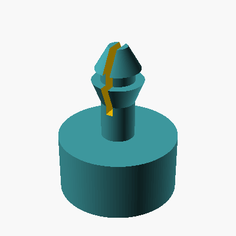
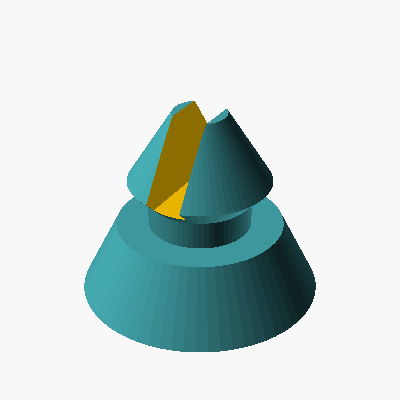
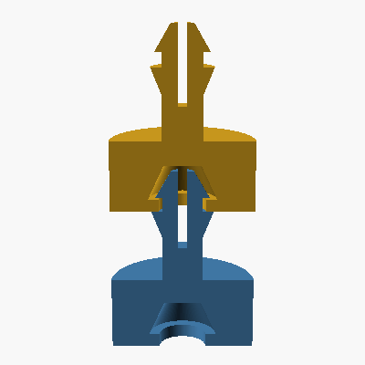

# snapfit-scad

An OpenSCAD library for round, slotted snap-fit pins that print without
supports: `snapfit()` makes the pin and `snapfit_neg()` the hole it snaps into,
to cut from the mating part. Add a foot to trap a plate between foot and head,
or an under chamfer for pins printed in flexible filament.

| Self-connecting disc | TPU foot with an under chamfer | Two discs snapped together, cut away |
| --- | --- | --- |
|  |  |  |

## Install

Clone it into your OpenSCAD library folder, or next to your project:

```sh
git clone https://github.com/CameronBrooks11/snapfit-scad.git
```

```openscad
use <snapfit-scad/snapfit.scad>;
```

**Set `$fn` in your own file.** The library's own `$fn` doesn't carry through
`use`, so without it you get OpenSCAD's coarse default: the default pin
renders in 72 triangles, against 996 at `$fn = 128`.

## The pin and the hole

The pin is a column of diameter `dia` with a cone-shaped head on top. The
head's base is `lip` wider than the column, and a slot down through the head
lets its two halves flex together as it goes through the hole.

`snapfit_neg()` is the matching hole, to subtract from the part the pin goes
into. Its throat is `dia` across, the column's own size, so the head has to
squeeze through, then a pocket above gives the head `neg_tol` of clearance once
it's through.

`thickness` changes both:

- On `snapfit()` it adds a foot: a cone on the column, `thickness` below the
  head. The other part is trapped between foot and head.
- On `snapfit_neg()` the narrow hole is `thickness` deep, the plate the head
  snaps past.

## Parameters

Both modules compute the head from `dia` and `lip`: it's `(dia + lip) / 2`
tall, with a base radius of `(dia + lip) / 2`, and narrows to `dia / 2` across
at the top.

### snapfit

| Parameter | Default | Description |
| --- | --- | --- |
| `dia` | `3` | Column diameter, before `col_tol`. |
| `lip` | `0.75` | How much wider the head's base is than `dia`. |
| `col_h` | `6` | Column height, from the base to the head. |
| `col_tol` | `0.1` | Taken off the column's radius. |
| `slot_ratio` | `0.7` | The slot's depth, as a fraction of column plus head height. |
| `thickness` | `undef` | If set, adds a foot with this gap below the head. |
| `under_chamfer_angle` | `undef` | If set, adds a cone of this angle under the head, so the catch is a slope instead of a step. Added for printing in flexible filament; the TPU example uses 45. |

### snapfit_neg

| Parameter | Default | Description |
| --- | --- | --- |
| `dia`, `lip`, `col_h`, `slot_ratio` | as above | Match the pin. |
| `neg_tol` | `0.5` | Clearance around the head in the pocket. |
| `thickness` | `undef` | If set, the hole is this deep; otherwise `col_h`. |
| `flip` | `false` | Mirrors the hole top to bottom, for a pin entering from above. |
| `under_chamfer_angle` | `undef` | Clearance for a pin with an under chamfer. |

Positional arguments follow the order in the tables, as in the examples:
`snapfit(dia, lip, col_h, col_tol, slot_ratio, thickness = thickness)`.

Use these names. Older copies of this README listed `diameter`,
`column_height`, `column_tolerance` and `negative_tolerance`, which OpenSCAD
ignores with a warning.

## Examples

- `examples/self_connecting_snap.scad`: a 10 mm disc with a pin on top and a
  hole underneath, so copies stack. Seated, each copy rests on the foot of the
  one below, 10 mm higher.
- `examples/pcb_feet_tpu.scad`: a tapered foot with a short pin and an under
  chamfer, to push into a board's mounting hole.
- `examples/stacked_pair.scad`: two self-connecting discs seated together and
  cut in half, to show how the pin sits in the hole. For looking at, not
  printing.

The earlier versions of the first two were printed on a Prusa MK3S with a
0.4 mm nozzle, with these settings from their PrusaSlicer projects (removed
from the repo but in its history). The rewritten geometry hasn't been printed
yet.

| | self_connecting_snap | pcb_feet_tpu |
| --- | --- | --- |
| Filament | PLA (Polymaker PLA Pro), 210 °C, bed 60 °C | Generic FLEX, 228 °C (230 first layer), bed 50 °C |
| Layer height | 0.05 mm, first layer 0.2 mm | 0.1 mm, first layer 0.2 mm |
| Perimeters | 3 | 4 |
| Infill | 25 % gyroid | 0 % |
| Top / bottom layers | 14 / 10 | 8 / 7 |
| Other | 5 mm brim | extrusion multiplier 1.12 |

## Checks

`just test` takes about 1 s on OpenSCAD 2026.10.15. It checks each module's
size, with and without `thickness` and `under_chamfer_angle`, and the
examples. Then it stacks two self-connecting copies (`tests/fit.scad`). Seated,
they only touch. 0.1 mm closer, they overlap. Lifted 1 mm, the head overlaps
the throat for 0.625 mm, which is the snap. It also checks that `flip` mirrors the
hole. The checks are geometry: how well a pin snaps and holds depends on the
material and the print. `just images` renders the pictures above.

## Origin and licence

The library is a rewrite, under MIT, of an idea from jpearce's
[Parametric OpenSCAD Snap Fit](https://www.thingiverse.com/thing:1799553) on
Thingiverse: a slotted round pin and the hole it snaps into. The code is new;
the modules and their parameters keep their names and order, so existing calls
still work, though the pin's and hole's exact shapes have changed. The earlier
GPL-3.0 versions are in this repository's history. MIT; see [LICENSE](LICENSE).
